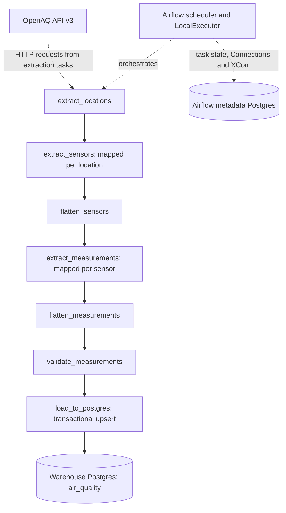

# Architecture and dynamic mapping

The first mapped stage had **16 location instances**, and the second had **22
sensor instances** in the documented manual run. Mapping is runtime fan-out;
measurement concurrency is deliberately limited to one instance at a time.
The API is also called by both mapped extraction stages; the dotted source edge
is a conceptual data-source relationship, not another Airflow task dependency.
The warehouse and metadata database use separate containers and named volumes.

| Component | Role | Address |
| --- | --- | --- |
| Airflow webserver (`airflow-apiserver` service) | UI and API | localhost:8080 |
| Scheduler / LocalExecutor | Schedules and executes task processes | Compose network |
| Standalone DAG processor | Parses DAG definitions | Compose network |
| Metadata Postgres | Runs, states, Connections and XCom | airflow-metadata:5432 |
| Warehouse Postgres | Air-quality measurements | warehouse:5432; host localhost:5434 |

TaskFlow return values become XComs. Flatten steps convert the mapped lists of
lists into lists for the next mapping or validation stage. Warehouse rows have
natural key `(sensor_id, measured_at)`.
